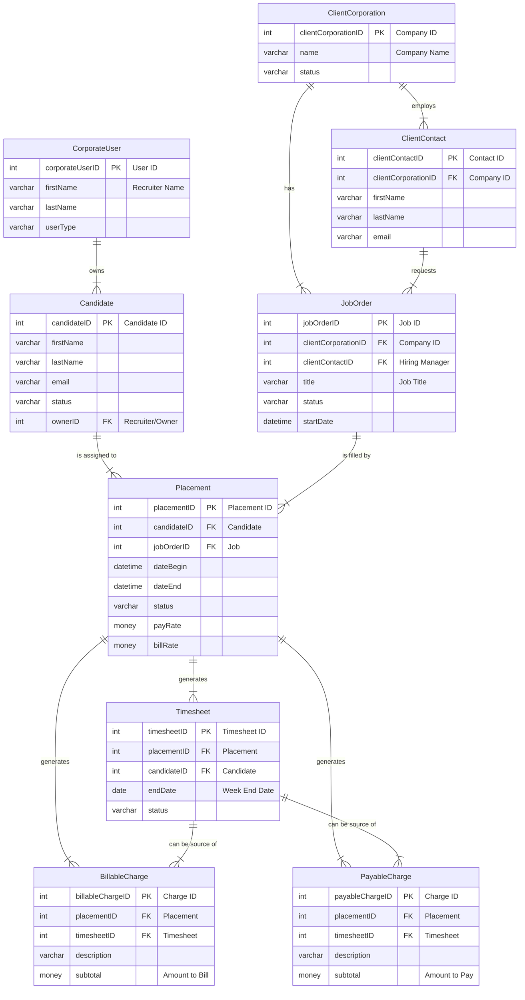

# Bullhorn Timecard Integration — Technical Reference

*Prompted and edited by Lawrence Ham*

Consolidated from: `01-whatWeActuallyNeedFromBullhornForBTETimecardInserts`, `bullhornEntityWorkflow`, `bullhornInsertTimecardEntity`, `bullhornRouteToPlacement`.

## Overview — Two Distinct Systems

Don't conflate these:

- **Bullhorn REST API (ATS/CRM)** — candidates, jobs, placements, timecard entities. This is what `bullhorn.github.io` documents.
- **BTE / Peoplenet (Time & Expense)** — the *separate legacy* punch/time engine with its own Web Services (SOAP) credentials. **Standard Bullhorn REST keys (`BhRestToken`) do NOT work against BTE.**

General strategy: **writes** (inserting punches/timecards) go through the appropriate API; **reads** can go straight to the **Partners BH-DB-Mirror** SQL database to minimize API calls. (Dev note: the BTE shape resembles the old Adapt SOAP integration.)

---

## Entity Schema (ERD)

The `Placement` table is the central hub, linking almost every key part of the workflow: from `Client` and `Candidate` through the `JobOrder` and `Placement`, to financial transactions like `Timesheet` and `BillableCharge`/`PayableCharge`.



Relationships:

- A **`ClientCorporation`** (client company) can have multiple **`JobOrder`** records.
- A **`Candidate`** is the person being placed.
- The **`Placement`** is the most critical table — the "join" that officially connects a `Candidate` to a `JobOrder`, creating an assignment (carrying `payRate`/`billRate`).
- Each `Placement` can generate multiple **`Timesheet`** records over its duration (one per week, `endDate` = week-ending date).
- **`BillableCharge`** (what the client owes) and **`PayableCharge`** (what the candidate is owed) are non-hourly financial transactions tied to a `Placement`, optionally sourced from a `Timesheet`.
- A **`CorporateUser`** (recruiter/salesperson) typically "owns" the `Candidate` record.

---

## Bullhorn REST API

### API Base

```
https://rest{cluster}.bullhornstaffing.com/rest-services/{corpToken}/
```

`{cluster}` is the cluster number (e.g. `21`, `90`).

### Auth (OAuth 2 → BhRestToken)

Server-to-server flow (password grant):

1. `POST https://auth.bullhornstaffing.com/oauth/token?grant_type=password&username=...&password=...&scope=rest` → `access_token`
2. `POST {apiUrl}/login?version=*&access_token={access_token}` → returns `restUrl` + `BhRestToken`
3. Every subsequent call sends the `BhRestToken` header (plus `Content-Type: application/json`).

### Key Entities

| Entity | Role |
|---|---|
| **Candidate** | The associate. Has `status`, `owner`, `customText1`–`customText40`. |
| **JobOrder** | The assignment. Linked to `clientCorporation`; status `Open`/`Filled`/`Cancelled`. |
| **Placement** | **The critical join**: candidate ↔ jobOrder. Has `dateBegin`/`dateEnd`, `status`, `payRate`/`billRate`, `employmentType`. |
| **Timecard** | Header only. `weekEndDate` is a **Sunday**. Status `New`/`Submitted`/`Approved`/`Processed`. **No hours on the header.** |
| **TimecardTime** | Line items: links `timecard`, `day` (1–7), `hours`, `earnCode`, optional rate overrides. |
| **EarnCode** | `Regular`, `Overtime`, `Holiday` — the IDs are needed for line items. |

### Insertion Flow (4 steps)

1. Gather the candidate + placement IDs.
2. `PUT entity/Timecard` — **no ID in the URL = create**. Body: `candidate: {id}`, `placement: {id}`, `weekEndDate`, `status: 'New'`.
3. Response returns `changedEntityId` — that's the new timecard ID.
4. `PUT entity/TimecardTime` **per day**: `timecard: {id}`, `day`, `hours`, `earnCode: {id}`.

```js
async function bullhornFetch(path, body = null, method = 'GET') {
  const opts = { method, headers: { 'BhRestToken': TOKEN, 'Content-Type': 'application/json' } };
  if (body) opts.body = JSON.stringify(body);
  const res = await fetch(`${restUrl}${path}`, opts);
  if (!res.ok) throw new Error(`Bullhorn ${method} ${path} → ${res.status}`);
  return res.json();
}

async function createTimecardForPlacement(candidateId, placementId, weekEndDate, dailyHours) {
  // 1. Create the timecard header (no id in URL)
  const tc = await bullhornFetch('entity/Timecard', {
    candidate: { id: candidateId },
    placement: { id: placementId },
    weekEndDate,
    status: 'New',
  }, 'PUT');
  const timecardId = tc.changedEntityId;

  // 2. Create one TimecardTime line item per day
  const entries = dailyHours.map(({ day, hours, earnCodeId }) =>
    bullhornFetch('entity/TimecardTime', {
      timecard: { id: timecardId },
      day, hours, earnCode: { id: earnCodeId },
    }, 'PUT')
  );
  await Promise.all(entries);
  return timecardId;
}
```

### Charges (pay the candidate / bill the client)

- **PayableCharge** — pays the candidate.
- **BillableCharge** — bills the client.

Both: `placement`, `transactionDate`, `quantity` × `rate`, `description`, `billable`/`payable` flags. A pair is **not** required — you can create one without the other.

### Routing to a Placement (lookup funnel)

Given a person (and maybe a client), find the right **Placement** before insertion or validation:

1. **Fast path** — if a `placementId` is provided: `GET entity/Placement/{id}`, require `status: 'Approved'`.
2. Otherwise search **Candidate** by `firstName`/`lastName` with `isDeleted: false`.
3. Search **ClientCorporation** by name.
4. Search **Placement**:
   `candidate.id IN (...) AND jobOrder.clientCorporation.id IN (...) AND status: 'Approved'`
   with a `fields` param that includes nested enrichment:
   `candidate(id,firstName,lastName),jobOrder(id,title,clientCorporation(id,name))`.

A `parseName` helper: the **last token** of a full name is the last name.

| Result count | Meaning |
|---|---|
| 0 | `NOT_FOUND` |
| 1 | `SUCCESS` |
| 2+ | `AMBIGUOUS` — concurrent placements for the same client are possible; present options to the user. |

Best practices: always filter `status: 'Approved'`; `isDeleted: false` on primary searches; use the `fields` param with nested enrichment to avoid extra round-trips; return a structured `{ status, data }`.

Official docs: `https://bullhorn.github.io/rest-api-docs`.

---

## BTE / Peoplenet — Time & Expense Engine (Punches)

We're integrating a client who uses **Bullhorn Time & Expense (BTE), aka Peoplenet**. It's a separate legacy system with its own Web Services credentials — standard Bullhorn REST keys won't work.

### The Request (support ticket script)

Submit via the **Bullhorn Resource Center** (or `support@bullhorn.com` if no portal access).

**Subject:** Developer Access Request: Peoplenet Web Services (BTE API)

> We are implementing a custom integration for Partners Personnel and require programmatic access to the Bullhorn Time & Expense (Peoplenet) backend — specifically the **Peoplenet Web Services (SOAP API)** to upload time and attendance data.
>
> Please provide:
> 1. **Integration credentials:** a dedicated API Username + Password for the Peoplenet environment.
> 2. **WSDL / documentation:** the latest PDF or WSDL link for the Peoplenet Web Services.
> 3. **Environment details:** the tenant's **Group ID / Client ID** and the correct **Service URL** (e.g. `https://www.mypeoplenet.com/.../RunWS.asmx`).
>
> *Note: we do NOT want the standard Bullhorn REST API (BhRestToken) credentials.*

**If they push back** (confused, or send a link to `bullhorn.github.io` — the wrong API):

> "We are not trying to access ATS/CRM data. We need to push/pull time-clock data directly from the **Time & Expense engine (Peoplenet)**, which requires the **'RunWS.asmx'** SOAP endpoints. Please escalate to the Time & Expense integration team."

**Definition of success:** a PDF (usually 100+ pages) titled "Peoplenet Web Services" plus a SOAP endpoint URL ending in `.../RunWS.asmx`.

### Findings (researched 2020s–2025)

**There is no modern public REST API for importing time punches into BTE.** The "Bullhorn REST API" on `bullhorn.github.io` is strictly ATS/CRM (candidates, jobs, placements) — it does not talk to the Time & Expense engine. There are exactly two ways to import punches programmatically.

#### Option 1 — Real-time (SOAP API)

The only true API path. Legacy Peoplenet Web Services (`RunWS.asmx`): ugly, XML-based, undocumented publicly, but it's what we want.

- **Endpoint:** `https://www.mypeoplenet.com/[TenantID]/RunWS.asmx`
- **Method:** `RecordRawPunch` or `ImportTime` (depends on the WSDL version).
- Craft the XML yourself (no SOAP library needed); post as `text/xml` with a `SOAPAction` header (e.g. `http://peoplenet.com/RecordRawPunch`).

```xml
<soap:Envelope xmlns:soap="http://schemas.xmlsoap.org/soap/envelope/">
  <soap:Body>
    <RecordRawPunch xmlns="http://peoplenet.com/">
      <sec>
        <Username>...</Username>
        <Password>...</Password>
        <Group>...</Group>
      </sec>
      <punch>
        <EmployeeId>12345</EmployeeId>
        <DateTime>2023-10-27T08:30:00.000Z</DateTime>
        <Type>I</Type> <!-- 'I' = In, 'O' = Out -->
      </punch>
    </RecordRawPunch>
  </soap:Body>
</soap:Envelope>
```

#### Option 2 — Batch (automated CSV)

Fallback if SOAP proves too brittle or support won't hand over the WSDL. BTE has a robust "Time Import" engine for flat files.

Workflow: query the DB for new punches → generate a CSV in the standard layout (usually `SSN, Date, Time, In/Out`) → SFTP it to the BTE drop box (Bullhorn provides the SFTP target).

### Summary

- **REST API?** No.
- **NPM package?** No.
- **Bullhorn One API?** Only if using "Bullhorn One" for *Pay & Bill* with the "Transaction Uploader" configured — but that typically **bypasses the time-clock engine entirely**.
- **Recommended path:** push hard for the **SOAP WSDL** (Option 1) — real-time validation (e.g. rejecting a bad ID punch immediately) is critical for a good UX.
